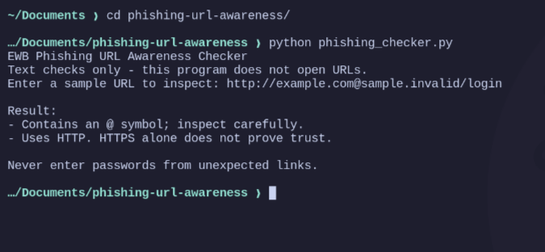
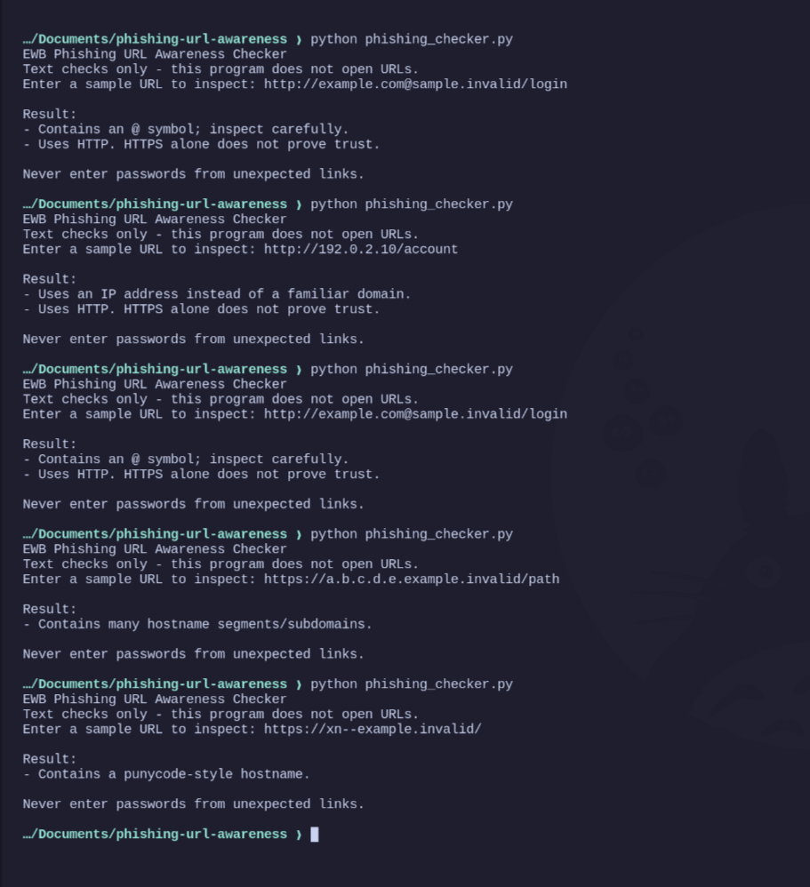
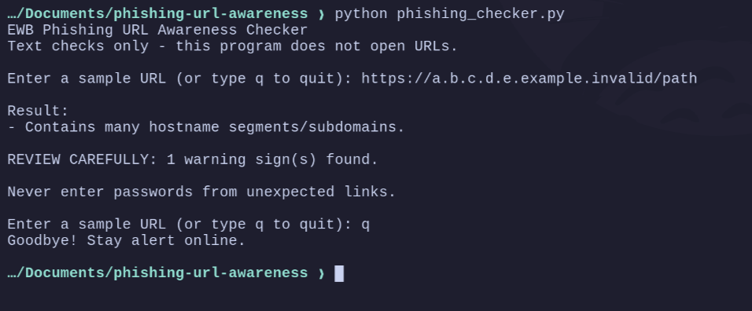

# EWB Phishing URL Awareness Checker
## Overview
Phishing is an online scam where attackers will try to get users to provide personal data via fake/suspicious links. This tool has been made using python to detect common red flags for URLs such as the presence of @ symbols, IP addresses and HTTP. 

(This is a learning project, and it cannot guarantee that a URL is safe.)

## Features

- Detects an `@` symbol in the URL.
- Flags URLs longer than 100 characters.
- Identifies IP addresses used as hostnames.
- Flags hostnames with five or more segments.
- Detects punycode-style hostnames containing `xn--`.
- Flags URLs that use HTTP.
- Allows checking multiple URLs without restarting the program.
- Displays a `REVIEW CAREFULLY` summary when warning signs are found.

## Requirements

- Python 3.10 or later.
- No extra Python packages are required.
## How to Get the Project

This project can be accessed in two ways:

- Git clone. Clone this repo onto your computer.

  ```bash
  git clone https://github.com/M-Yaasir7/phishing-url-awareness.git
  cd phishing-url-awareness
  ```

- Download ZIP. To download this project as a .ZIP file, go to GitHub and download the file.

### How to Run

**Linux/macOS:**

```bash
python3 phishing_checker.py
```

**Windows:**

```bash
python phishing_checker.py
```
### Example: URL with Warning Signs

**Input:** `http://192.0.2.10/account`

```text
EWB Phishing URL Awareness Checker
Text checks only - this program does not open URLs.

Enter a sample URL (or type q to quit): http://192.0.2.10/account

Result:
- Uses an IP address instead of a familiar domain.
- Uses HTTP. HTTPS alone does not prove trust.

REVIEW CAREFULLY: 2 warning sign(s) found.

Never enter passwords from unexpected links.
```
## Testing

I tested the program using five sample URLs to check whether it detects the expected warning signs.

All five test cases and their actual results are documented in [tests/test_samples.md](tests/test_samples.md).
## Screenshots

### Sample Program Run


### Test Results

## Improvements

1. `Loop with quit:` I added a loop to my program so users can check multiple URLs without restarting it. I tested this by entering different URLs and then typing `q` to quit.

2. `Warning summary:` I added a message saying REVIEW CAREFULLY to let users know how many warning signs were found. I tested this using a URL that produced two warnings.
### Test Results



## Limitations

This is an educational tool. It only reads URL text. It does not visit URLs, scan for malware, or prove that a URL is safe. Finding no warning signs does NOT mean a URL is safe.

## Ethical Use

I use sample URLs for testing and learning. I do not collect credentials, use this project to deceive anyone, or test websites without permission.

## Author

**Name:** Mohammad Yasir  
**Course:** AI Powered Cybersecurity Internship

 EWB Courses